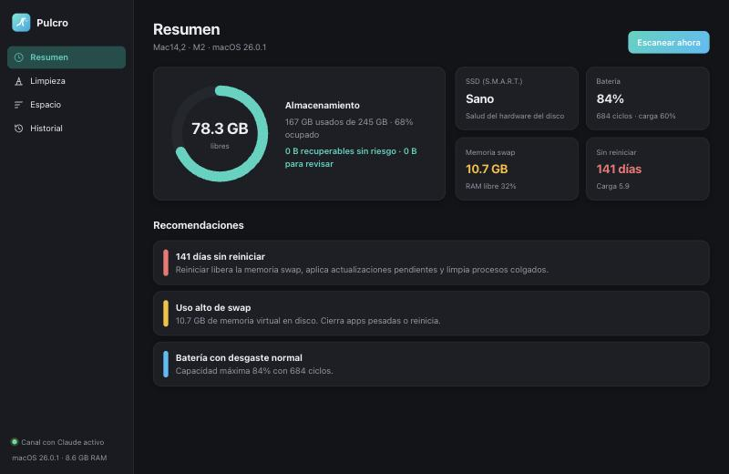
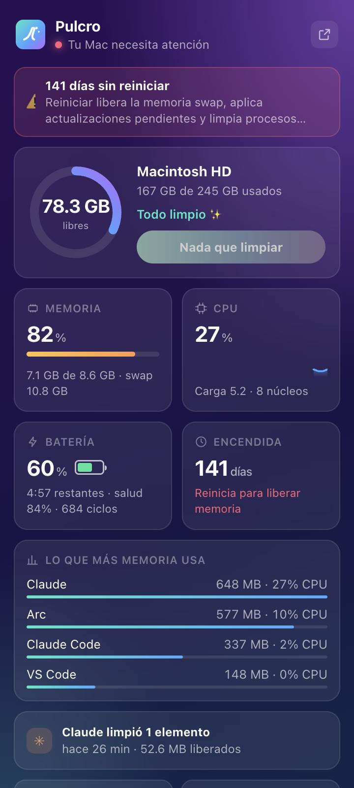

# Pulcro

Limpiador y monitor de salud para macOS, con estilo CleanMyMac y un canal MCP para que **Claude** revise y limpie tu Mac contigo.

<p align="center">
  
  &nbsp;
  
</p>

## Qué hace

- **Resumen**: espacio libre, salud del SSD (S.M.A.R.T.), batería, memoria swap, días sin reiniciar y recomendaciones.
- **Limpieza**: encuentra lo que se puede borrar sin riesgo:
  - cachés de apps y logs
  - cachés de desarrollo: npm, pnpm, Homebrew, Gradle, Maven, NuGet, Cargo, Xcode, Android, Arduino
  - `node_modules`, `.next`, `target`, `.venv`… de tus proyectos, marcando los que llevan tiempo sin usarse
  - versiones viejas de extensiones de VS Code y Cursor
  - instaladores olvidados (`.dmg`, `.pkg`, `.iso`) y archivos de más de 1 GB
- **Espacio**: qué apps y carpetas pesan más. Desde aquí también vacías la Papelera.
- **Barra de menús**: panel con disco, memoria, CPU y batería en vivo, las apps que más memoria consumen y un botón para limpiar.
- **Historial**: lo que hiciste tú y lo que hizo Claude, actualizado en vivo.

## Instalación

### Requisitos

- macOS 13 o superior (probado en macOS 26, Apple Silicon)
- [Node.js](https://nodejs.org) 20 o superior. Con Homebrew:

  ```bash
  brew install node
  ```

### Pasos

1. Descarga **`Pulcro-x.y.z.dmg`** desde [Releases](https://github.com/Calebpyn/pulcro/releases/latest).
2. Abre el DMG y arrastra **Pulcro** a **Aplicaciones**.
3. **La primera vez**, macOS la va a bloquear porque no está notarizada por Apple. Haz **clic derecho en Pulcro → Abrir → Abrir**. Solo se hace una vez.

   Si macOS dice que la app "está dañada", corre esto y vuelve a abrirla:

   ```bash
   xattr -dr com.apple.quarantine /Applications/Pulcro.app
   ```

4. En el primer escaneo, macOS te pedirá permiso para que Pulcro lea **Escritorio, Documentos y Descargas**. Acepta, porque ahí busca tus proyectos.

### Uso diario

- Pulcro vive en la **barra de menús** (✨). Clic izquierdo abre el panel; clic derecho, el menú rápido (abrir, iniciar con la sesión, salir).
- Si cierras la ventana, Pulcro sigue en la barra de menús. **Cmd+Q** la cierra por completo.
- Activa **"Abrir al iniciar sesión"** desde el clic derecho para que arranque sola al prender la Mac.

## Conectar Claude (MCP)

Pulcro incluye un servidor [MCP](https://modelcontextprotocol.io) para que Claude Code y Claude Desktop puedan revisar y limpiar tu Mac.

```bash
git clone https://github.com/Calebpyn/pulcro.git
cd pulcro
npm run register
```

Esto registra el servidor `pulcro` en Claude Code y lo agrega a la configuración de Claude Desktop, guardando antes un respaldo. Después **reinicia Claude Desktop** y pide algo como:

> "Usa Pulcro para revisar la salud de mi Mac y dime qué puedo limpiar"

| Herramienta | Qué hace |
| --- | --- |
| `system_health` | Disco, SSD, batería, RAM, swap, días encendida y recomendaciones |
| `scan_cleanup` | Lista lo que se puede limpiar, con ID, tamaño y riesgo |
| `space_breakdown` | Apps, datos de apps y carpetas más pesadas |
| `clean_items` | Limpia por ID. Claude te pide permiso antes de usarla |
| `get_history` | Últimas acciones tuyas y de Claude |

Cada acción de Claude aparece al instante en la app.

## Seguridad

- Lo **seguro**, que se regenera solo, se borra. Lo **a revisar** va a la Papelera y lo puedes recuperar.
- Antes de tocar cualquier cosa, Pulcro vuelve a validar cada ID contra sus reglas ([`src/core/rules.js`](src/core/rules.js)). Solo acepta rutas canónicas, sin enlaces simbólicos, dentro de tu usuario y del tipo correcto.
- Keychains, iCloud, Mail, Mensajes, Fotos, `.ssh` y los contenedores de apps están protegidos.
- El motor solo escucha en `127.0.0.1` y rechaza peticiones de otros sitios.
- Por MCP, Claude nunca puede vaciar la Papelera.

## Desarrollo

```bash
npm install
npm start            # interfaz en http://127.0.0.1:4747
npm run build:app    # compila ~/Applications/Pulcro.app (motor incluido)
npm run build:dmg    # genera dist/Pulcro-<versión>.dmg
npm run register     # registra el MCP en Claude Code y Claude Desktop
```

Para compilar la app nativa se necesitan las Command Line Tools de Xcode:

```bash
xcode-select --install
```

### Estructura

```
src/core/     motor: salud, escaneo, reglas de seguridad, limpieza, historial, métricas en vivo
src/server.js servidor local (API + eventos en vivo)
src/mcp.js    servidor MCP para Claude
public/       interfaz (ventana principal y panel de la barra de menús)
macos/        app nativa en Swift (ventana + barra de menús)
scripts/      compilación de la app, del DMG y registro en Claude
future/       funciones en pausa (asistente de chat con Claude)
```

Para agregar carpetas de proyectos, crea `~/Library/Application Support/Pulcro/config.json`:

```json
{ "projectRoots": ["~/Code", "~/Work"] }
```
